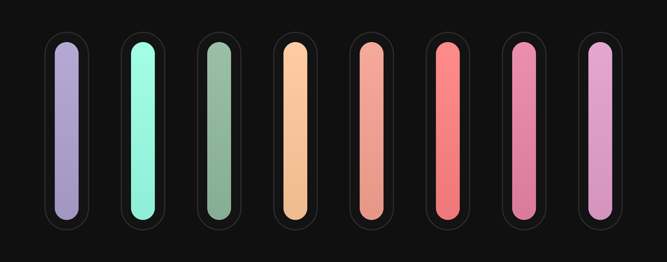

# herdrZed

Two independent Herdr sets in one repo:

- [herdr-vesper](herdr-vesper/) — the Vesper theme
- [herdr-zed](herdr-zed/) — the flat Zed-style layout

They work separately: the theme supplies the palette, the layout supplies the structure, fonts and the **Zed** button. Each piece has its own `RECIPE.md`.

## Install

- Theme: copy `herdr-vesper/themes/` into your Herdr app home.
- Layout: copy `herdr-zed/layouts/` and `herdr-zed/mods/` into your Herdr app home.

Then:

```sh
herdr-app do layout.switch --name herdr-zed
```

Pick **vesper** in Settings → Look for the preview look.
