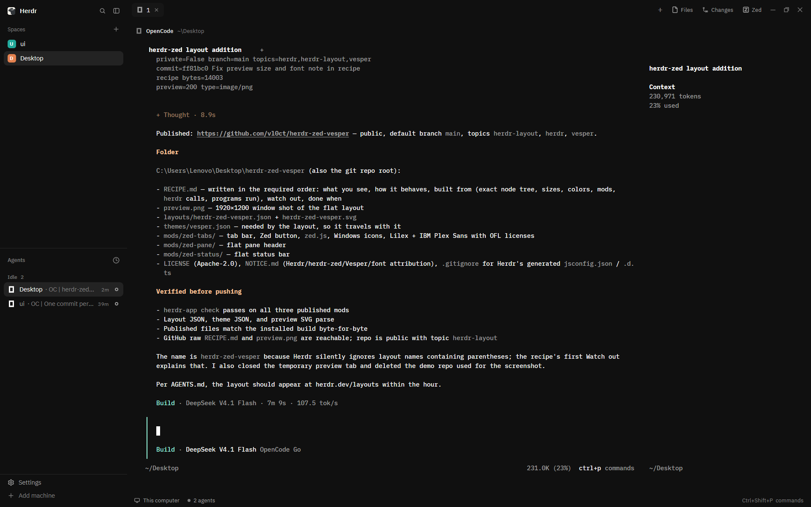

# Herdr Zed Vesper

A Herdr layout that makes the window look like Zed running Vesper: flat `#101010` chrome, peppermint and orange accents, Lilex in the terminals, IBM Plex Sans in the panels, and a **Zed** button in the tab bar that opens the active space's git repository in Zed — locally, or as a remote project over SSH.



## What you see

The window has no system title bar. Left to right: a 268 px sidebar, the work column, and a right panel that starts hidden.

**Sidebar** — background `#101010`, 268 px wide (min 44, max 480, fixed). Top to bottom:
- A 46 px brand row (`workspace-chrome`): the Herdr mark, a search button and a sidebar toggle. Dragging it moves the window.
- The spaces list and the agents list, each `weight: 1` with `min: 90`, splitting the middle. The selected space row is `#232323` with white text and an accent `#FFC799` marker; other rows are `#A0A0A0`.
- A 69 px footer (`workspace-chrome` with `props: {footer: true}`): Settings and Add machine.

**Tab bar** — 42 px tall (`zed-tabs`), background `#101010`, no bottom border. Tabs are 29 px high, `rounded(7)`, 10 px side padding, 7 px gap, 12.8 px text, 3 px apart. The active tab is `#161616` with `#FFFFFF` text; inactive tabs are transparent `#101010` with `#A0A0A0` text. A 14 px program icon sits before the name, which is capped at 170 px and truncated. A zoomed tab appends ` Z`. Working tabs show a spinning 12 px `workspace-chrome/spinner.svg` in `#FFC799`; blocked and done tabs show a 6 px dot in `#FF8080` / `#99FFE4`. The active tab has a 12 px close icon. After the tabs: a 26×26 **+** button, then **Files** and **Changes** buttons (26 px high, 8 px side padding, 5 px gap, 12 px text and 14 px icon; selected state `#232323`), then the **Zed** button (same shape, 14 px `zed.svg`, label `Zed`). On Windows and Linux the bar ends with 26×26 minimize, maximize/restore and close buttons with 16 px vector icons; on macOS the system traffic lights sit at `[12, 16]` and no buttons are drawn.

**Work body** — 8 px padding and 8 px gap around the terminal pane. The pane has background `#101010`, `radius: 0`, `gap: 8`, `lone: true`, and **no border and no focus ring**. Its 30 px header is always visible: a 14 px program icon, the program or agent name at 12 px `#FFFFFF` (medium, max 260 px, truncated), then the folder at `#7E7E7E` (home shown as `~`). Working panes show the 12 px spinner, blocked panes a pill reading `Needs you` (10.5 px semibold, `#FF8080` on `#FF808026`, 18 px high, `rounded(5)`), done panes a 7 px `#99FFE4` dot. Hovering the header reveals 14 px split-right, split-down, zoom/unzoom and close buttons. The terminal uses Lilex at 13 px with `terminal_padding: [14, 12]`.

**Right panel** — 368 px when shown (min 280, max 900), hidden at start. It is a stack with `files` (`files` mod) and `changes` (`changes` mod), default child `files`. Drag its left edge to resize.

**Status bar** — 28 px tall (`zed-status`), `#101010`, no top border, 14 px side padding, 16 px gaps, 11.8 px `#A0A0A0` text: a 13 px monitor/server icon and the machine name (`This computer` locally), the branch when there is one, a 6 px dot and `N agents`, and `· N needs you` in `#FF8080` when any agent is blocked. The right end shows the palette shortcut followed by `commands`; clicking it runs `app.palette`.

**Theme** (`themes/vesper.json`) — background, canvas, chrome and surface `#101010`; popover `#1A1A1A`; raised `#161616`; hover `#282828`; selected `#232323`; border `#282828`; input `#343434`; foreground `#FFFFFF`; muted `#A0A0A0`; dim `#7E7E7E`; accent `#FFC799` with accent foreground `#101010`; solid `#FFC799` with `#000000` text; working `#FFC799`, blocked `#FF8080`, done `#99FFE4`, idle `#A0A0A0`, unknown `#7E7E7E`; selection `#493C31`. ANSI, taken from Zed's Vesper: `#101010`, `#F5A191`, `#90B99F`, `#E6B99D`, `#ACA1CF`, `#E29ECA`, `#EA83A5`, `#A0A0A0`, then bright `#7E7E7E`, `#FF8080`, `#99FFE4`, `#FFC799`, `#B9AEDA`, `#ECAAD6`, `#F591B2`, `#FFFFFF`.

## How it behaves

- **Tabs:** click selects; double-click renames (`tab.rename`); dragging a tab onto another reorders it (`tab.move`); right-click opens the `menu` popup (200 px) for that tab; the wheel over the bar runs `tab.prev` / `tab.next`; **+** opens the `new-menu` popup at 250×512.
- **Files / Changes:** clicking shows the right panel on that stack child (`layout.show`, `layout.select`); clicking the selected button hides it (`layout.hide`). The open panel is remembered per space in `localStorage` and restored when that space comes back. A space that never had a panel starts closed. `shared("workspace.panels")` (default `["files","changes"]`) decides which of the two buttons exist.
- **Zed:** clicking shows `Opening…` in `#7E7E7E` and disables the button until the launch finishes. It resolves the folder as: `git rev-parse --show-toplevel` with the focused terminal's cwd (else the space folder) on the space's machine; else that cwd if absolute; else `home()` locally or `pwd` on a remote machine. A local space launches `zed <folder>`. A space on an SSH machine launches `zed ssh://<target><folder>` using the machine's `target` from `hc machine ls --json`. Success posts a 3 s `success` toast `Opened in Zed` with the target; failure posts an `error` toast `Could not open in Zed` with the reason. A click while opening, or with no active space, does nothing.
- **Agent statuses:** working = 900 ms spinner in tab and pane header, `#FFC799`; blocked = `#FF8080` dot in the tab and `Needs you` pill in the header, plus the blocked count in the status bar; done = `#99FFE4` dot; idle = no mark. Statuses never change the Zed button.
- **Pane header:** hovering flips the right-side buttons in (no layout shift); clicking the header runs `pane.focus` for that pane. Split buttons run `pane.split` with `{direction, pane}`, zoom runs `pane.zoom`, close runs `pane.close`.
- **Window:** the brand row and the tab bar are `window_drag: true`; double-clicking them maximizes. The Windows/Linux buttons run `window.minimize`, `window.maximize` and `window.close`; the maximize icon switches to `win-restore.svg` when maximized.
- **Hover:** tabs and buttons change to `#282828` with `#FFFFFF` text.
- **Focus:** there is no pane outline. The active tab and the terminal cursor are the only focus cues.
- **Zoom:** sizes are design pixels at zoom 1. At the screenshot's 0.9 zoom the 13 px terminal draws at 11.7 px.

## Built from

The layout tree (`layouts/herdr-zed-vesper.json`):

```
root row
  theme "vesper", font "Lilex", font_size 13, ui_font "IBM Plex Sans",
  background "canvas", terminal_padding [14, 12], titlebar "none",
  traffic_lights [12, 16], preview "layouts/herdr-zed-vesper.svg"
  ├ sidebar column  px 268, min 44, max 480, background "chrome", resizable false
  │ ├ brand block          px 46, window_drag, mod "workspace-chrome"
  │ ├ sidebar-lists column
  │ │ ├ spaces block       weight 1, min 90, mod "spaces"
  │ │ └ agents block       weight 1, min 90, mod "agents"
  │ └ sidebar-footer block px 69, mod "workspace-chrome", props {"footer": true}
  └ work column  resizable false
    ├ tabs block   px 42, window_drag, mod "zed-tabs"
    ├ work-body row  padding 8, gap 8
    │ ├ main block   content { tab: "active", pane: {
    │ │     header: { content: { mod: "zed-pane" }, reveal: "always",
    │ │               height: 30, position: "top" },
    │ │     background: "background", radius: 0, gap: 8, lone: true } }
    │ └ panel column px 368, min 280, max 900, hidden
    │   └ panel-body stack  active "files"
    │     ├ files block    mod "files"
    │     └ changes block  mod "changes"
    └ status block px 28, mod "zed-status"
```

Files:

| File | What it is |
|---|---|
| `layouts/herdr-zed-vesper.json` | the tree above |
| `layouts/herdr-zed-vesper.svg` | 320×200 Settings preview, crisp edges, flat Vesper chrome, no outlines |
| `themes/vesper.json` | the color table above |
| `mods/zed-tabs/` | tab bar; clone of the shipped `tabs` mod (0.1.12), flat (no tab pill or bar border), Zed button, bundled fonts |
| `mods/zed-tabs/zed.js` | resolves the folder and launches Zed; new file |
| `mods/zed-tabs/zed.svg` | 16 px rounded-square `Z` glyph, tinted |
| `mods/zed-tabs/win-*.svg` | 16 px Windows minimize, maximize, restore, close icons |
| `mods/zed-tabs/fonts/` | Lilex (6 weights/styles) and IBM Plex Sans (5), with OFL license files |
| `mods/zed-pane/` | pane header; clone of the shipped `pane` mod (0.1.13), bottom border removed, Windows `~` abbreviation |
| `mods/zed-status/` | status bar; clone of the shipped `workspace-status` mod (0.1.13), top border removed |

Shipped mods and assets it relies on: `workspace-chrome` (brand, footer, spinner and icons), `spaces`, `agents`, `files` and `files/file.svg`, `changes` and `changes/changes.svg`, `pane/close.svg` (tab close icon), `new-menu` (+ button) and `menu` (tab right-click). No shipped mod file is edited.

`zed-tabs/main.js` imports `spaces`, `panes`, `run`, `openOverlay`, `theme`, `window`, `shared`, `layout`, `settings` from `herdr`, and calls `layout.select`, `layout.show`, `layout.hide`, `tab.select`, `tab.move`, `tab.rename`, `tab.close`, `tab.prev`, `tab.next`, `window.minimize`, `window.maximize`, `window.close`. The pane header gets `{pane, terminal}` from the app and calls `pane.focus`, `pane.split`, `pane.zoom`, `pane.close`; the status bar calls `app.palette` and reads `keys()`, `window()`, `spaces()` and `agents()`.

Programs the layout runs: `git rev-parse --show-toplevel` and `pwd` (on the space's machine), `hc machine ls --json`, and one Zed CLI. No network access of its own. Fonts are Lilex and IBM Plex Sans under the SIL Open Font License; the code is Apache-2.0, with the Herdr-derived files listed in `NOTICE.md`.

## Watch out

- **Layout names cannot contain parentheses.** Herdr silently ignores `layouts/herdr(zed-vesper).json`: `layout.switch` reports `{"ok": true}` and the layout never changes. The working name is `herdr-zed-vesper`.
- Copy `themes/vesper.json` as well as the layout. Without it `theme: "vesper"` falls back to the default look.
- Copy the whole `mods/zed-tabs/fonts/` folder. Without the TTFs, `Lilex` falls back to JetBrains Mono and `IBM Plex Sans` to the system UI font. Keep the two OFL license files.
- If `zed-tabs`, `zed-pane`, `zed-status` or `vesper` are already taken, rename the folder/theme and update the layout's `content.mod` / `theme`, plus every `mods/zed-tabs/` and `mods/zed-pane/` asset path. If you start from the shipped clones instead, `herdr-app do mod.clone --name <name> --as <new>` rewrites the asset paths for you; hand renaming is easy to get wrong.
- This build targets Herdr 0.1.13. The tab bar, pane header and status bar are clones of shipped mods from 0.1.12/0.1.13 and are not updated by Herdr. If Herdr changes those mods, re-clone from the current shipped versions and re-apply the edits.
- The **Zed** button needs Zed and its CLI: `zed` on every platform, `/Applications/Zed.app/Contents/MacOS/cli` on macOS, and `Zed.exe` or `%LOCALAPPDATA%\Programs\Zed\bin\Zed.exe` on Windows. If none exist, `Opening…` returns to `Zed` and an error toast appears.
- Remote spaces need `hc machine ls --json` to return an ssh `target` for that machine. A machine connected with `via` is refused because Zed needs a real ssh host. Zed resolves the target through `~/.ssh/config`, and the remote folder must exist.
- The folder resolution runs `git` on the space's machine using the focused pane's cwd. A non-repository folder is used as-is; a missing cwd falls back to the machine's home.
- The shipped `pane` mod abbreviates only `home + "/"`; this build also handles `home + "\"` for Windows. Keep both if you rebuild the header.
- Do not add `border` or `focus` back to the pane frame, and keep the removed lines out of the tab bar, pane header and status bar; that is what makes the layout flat. Focus is shown by the active tab only.
- The right panel is hidden initially; `workspace.panels` must contain `files` and/or `changes` for the buttons to exist. The panel choice is per space and survives restarts in the mod's `localStorage`.
- The tab bar's left padding (`lightsPadding`) keeps macOS traffic lights from covering tabs when the sidebar is narrow or hidden. Keep it.
- Sizes are at zoom 1. On a 0.9 zoom the terminal is 11.7 px; raise `font_size` if you want a 13 px appearance there.
- The repo's `preview.png` is a 1920×1200 window shot at 0.9 zoom; `zed.svg` is a custom `Z` glyph, not the official Zed logo.
- Fonts add about 2.3 MB to the repository.

## Done when

- `herdr-app check mods/zed-tabs`, `herdr-app check mods/zed-pane` and `herdr-app check mods/zed-status` all print `check passed`.
- After copying `layouts/herdr-zed-vesper.json`, `layouts/herdr-zed-vesper.svg`, `themes/vesper.json` and the three mod folders, `herdr-app do layout.switch --name herdr-zed-vesper` returns ok and `herdr-app status` shows `"layout": "herdr-zed-vesper"` with `"errors": []`.
- The window matches `preview.png`: one flat `#101010` surface, no outline around the terminal pane, Vesper's orange accent, Lilex in the terminal, IBM Plex Sans in the panels.
- Clicking **Zed** in a local git repository shows `Opening…`, then the success toast, and Zed opens at the repository root. In an SSH space the same click opens `ssh://<host>/<repo root>`.
- **Files** and **Changes** open the 368 px right panel; clicking the selected one hides it; returning to a space restores its choice.
- **+** opens `new-menu`; right-clicking a tab opens `menu`; dragging a tab reorders it; double-clicking renames it.
- Hovering a pane header shows split-right, split-down, zoom/unzoom and close; clicking the header focuses that pane.
- The three window buttons minimize, maximize/restore and close on Windows; the status bar shows the machine, branch, agent count and palette hint.
