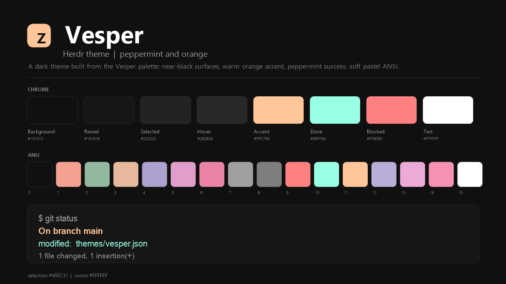

# Herdr Vesper

A dark Herdr theme built from the Vesper palette: near-black surfaces, warm orange accent, peppermint success, pink errors, and a soft pastel ANSI set. It colors the whole window — panels, tabs, dialogs and terminals — and has no layout of its own.



## What you see

When the theme is selected, every surface goes almost black and the accent turns warm orange.

- Background, canvas, chrome and surface: `#101010`
- Popovers and floating blocks: `#1A1A1A`
- Raised elements (active tab): `#161616`
- Hover: `#282828`; selected: `#232323`
- Border: `#282828`; input border: `#343434`
- Text: `#FFFFFF`; muted: `#A0A0A0`; dim: `#7E7E7E`
- Accent: `#FFC799`; text on accent: `#101010`
- Solid buttons: `#FFC799` with `#000000` text
- Agent states: working `#FFC799`, blocked `#FF8080`, done `#99FFE4`, idle `#A0A0A0`, unknown `#7E7E7E`
- Selection: `#493C31`; terminal cursor: `#FFFFFF`

The terminal ANSI palette:

| 0-7 | 8-15 |
|---|---|
| `#101010` `#F5A191` `#90B99F` `#E6B99D` | `#7E7E7E` `#FF8080` `#99FFE4` `#FFC799` |
| `#ACA1CF` `#E29ECA` `#EA83A5` `#A0A0A0` | `#B9AEDA` `#ECAAD6` `#F591B2` `#FFFFFF` |

## How it behaves

- Selecting **Vesper** in Settings → Look (or `app.theme --name vesper`) applies it to the whole window and to every terminal.
- The choice is **per layout** and is remembered. Other layouts keep their own theme.
- Switching to another theme recolors panels and terminal text immediately; nothing is restarted.
- It is a dark theme. It has no separate light variant.
- It does not change layout structure, fonts, key bindings or programs; it only supplies colors.
- The theme is data, not code: no network, no `exec`, no files outside its own JSON.

## Built from

One file, `themes/vesper.json`:

```json
{
  "background": "#101010",
  "foreground": "#ffffff",
  "selection": "#493c31",
  "cursor": "#ffffff",
  "ansi": [
    "#101010", "#f5a191", "#90b99f", "#e6b99d", "#aca1cf", "#e29eca", "#ea83a5", "#a0a0a0",
    "#7e7e7e", "#ff8080", "#99ffe4", "#ffc799", "#b9aeda", "#ecaad6", "#f591b2", "#ffffff"
  ],
  "colors": {
    "canvas": "#101010",
    "chrome": "#101010",
    "surface": "#101010",
    "popover": "#1a1a1a",
    "raised": "#161616",
    "hover": "#282828",
    "selected": "#232323",
    "border": "#282828",
    "input": "#343434",
    "foreground": "#ffffff",
    "muted": "#a0a0a0",
    "dim": "#7e7e7e",
    "accent": "#ffc799",
    "accent_foreground": "#101010",
    "solid": "#ffc799",
    "solid_foreground": "#000000",
    "working": "#ffc799",
    "blocked": "#ff8080",
    "done": "#99ffe4",
    "idle": "#a0a0a0",
    "unknown": "#7e7e7e"
  }
}
```

The palette comes from Vesper by Rauno Freiberg (<https://github.com/raunofreiberg/vesper>) as ported to Zed by bdsqqq (<https://github.com/bdsqqq/vesper-zed>). The file name is the theme name Herdr offers: `themes/vesper.json` → **vesper**.

`preview.png` is an original 1200×675 palette card drawn for this theme. It is not part of the theme.

## Watch out

- The **file stem is the theme name**. `themes/vesper.json` is offered as `vesper`; renaming the file renames the theme in the picker.
- Copy it to the Herdr app home's `themes/` folder (`~/.config/herdr-app/themes/vesper.json`), not the layout folder. A theme file in `mods/` or `layouts/` is ignored.
- Herdr reads theme files at start and on look changes. If the file is invalid, the app keeps the last good look; check `herdr-app status` and the app home for errors.
- A layout with an explicit `"theme"` at its root beats the picker's per-layout choice. If a theme does not seem to change a particular layout, remove that layout's `theme` field.
- The `colors` block is what makes the panels and status colors match the terminals. Without it Herdr derives panel colors from `background` and `foreground`, which loses the orange accent and the `#161616`/`#232323` steps.
- The theme is dark. Do not pair it with a light system appearance expecting a light variant; it is applied as written.
- If a theme named `vesper` already exists, rename the file and pick the new name. Nothing else references the name unless a layout pins it.

## Done when

- `themes/vesper.json` is valid JSON and copying it into `~/.config/herdr-app/themes/` makes **vesper** appear in Settings → Look.
- Selecting it turns the window background `#101010`, the accent `#FFC799`, the active tab `#161616`, hover rows `#282828`, and text `#FFFFFF`.
- Terminal output uses the ANSI set above — for example, green strings are `#99FFE4` and red errors `#FF8080`.
- Picking **Graphite** and then **vesper** changes the window back and forth without restarting anything; other layouts keep their own theme.
- `herdr-app status` reports no theme errors.
